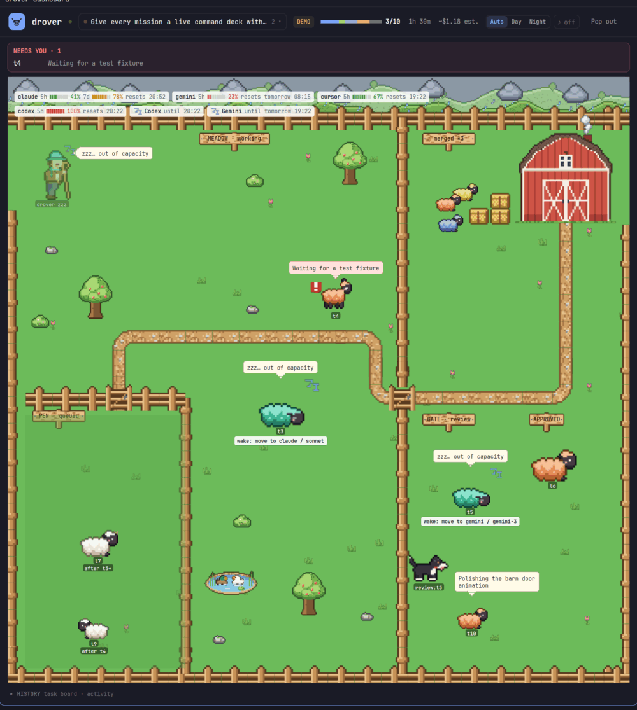
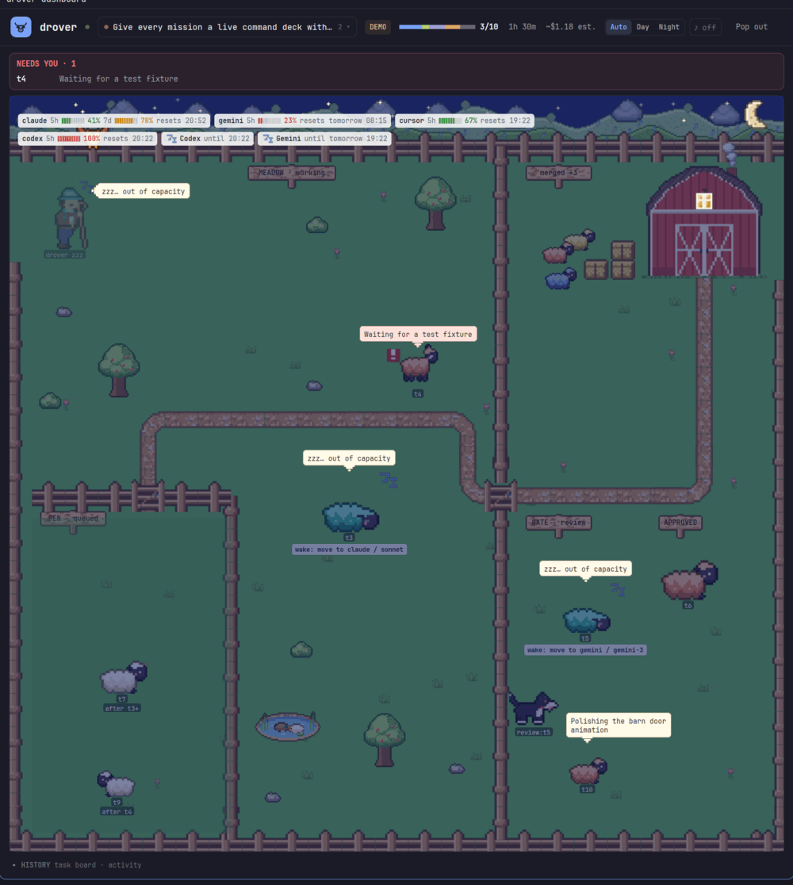
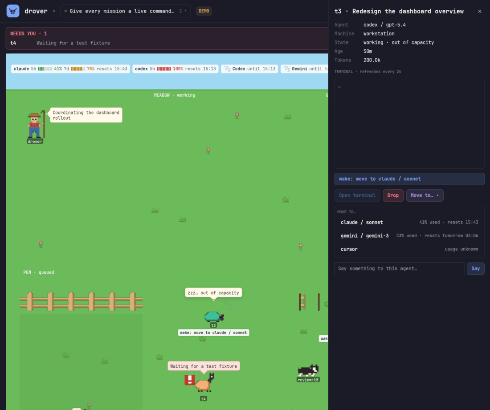
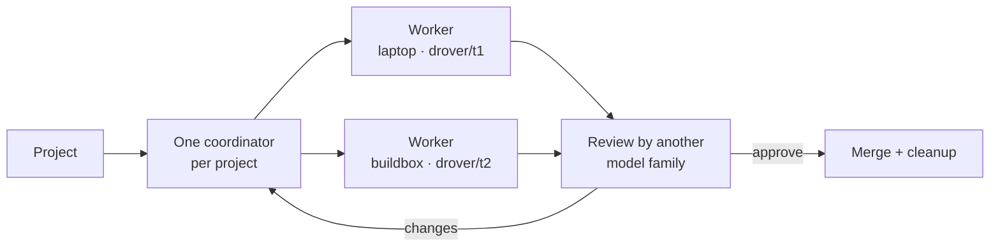

<div align="center">

<!-- docs/banner.svg is a fixed-colour copy of the rail icon, which uses currentColor and turns black on dark themes -->


# drover

**Coding agents across all your machines, driven from the [Herdr](https://herdr.dev) app.**


</div>

drover decides **which agent, which model and which machine** each task gets, keeps long
runs on machines that stay on, and cleans up once the work is merged.

| | |
|---|---|
| 🛰️ **Fleet probe** | Online, CPUs, load, memory, disk, mains or battery and installed agent CLIs, for every machine `hc` knows. |
| 🎯 **Placement** | Per role (coordinator, worker, reviewer, mechanical) an ordered agent + model chain; every skipped option comes with its reason. |
| 🌿 **Isolated work** | Each task gets its own `drover/<task>` branch and worktree on the machine it runs on. |
| 🧑‍✈️ **Missions** | One coordinator per project plans, hands out tasks and merges; reviewers come from another model family. |
| 🤖 **Unattended** | `--auto` runs a mission's agents without approval prompts; `--image` hands them mockups. |
| 🐑 **Quota-aware** | Reads each agent's plan usage, skips agents that are out, prefers ones with headroom. |
| 🐕 **Watcher** | Moves stuck or out-of-capacity tasks to the next choice; restarts a dead coordinator. |
| 🔁 **Handover** | Right-click a coordinator (or click the drover) to hand it to another agent, with its missions and your last message. |
| 📊 **Pasture** | Per project: a live pixel farm. Sheep are tasks, the sheepdog reviews, merged work goes to the barn; day and night follow your clock. Pop it out into its own window. |

<p align="center">
  
  
</p>
<p align="center">
  
</p>



## Install

```sh
./install.sh   # links the engine, mods, layout and theme; adds ctrl-shift-d
```

Then press `ctrl-shift-l` in Herdr until the drover layout shows. After editing mods here,
switch layouts twice to reload. Settings: `~/.config/drover/config.json` (the gear on the left rail
opens the settings dialog); probe cache: `~/.local/state/drover/fleet.json`.

**Herdr gallery:** `herdr/` is a shareable Herdr layout (layout, mods,
[RECIPE.md](herdr/RECIPE.md), preview). Installed from the gallery it still needs this repo's
engine: clone it and run `./install.sh`.

## Commands

```sh
drover probe                                 # what every machine can do now
drover status                                # machines + running drover agents
drover route worker                          # where a worker would go, and why
drover run worker --repo ~/Work/x "fix the login test"   # one agent (--dry-run)
drover cleanup --repo ~/Work/x               # dry run: merged drover/* branches + worktrees
drover cleanup --repo ~/Work/x --yes         # really remove them
drover project list                          # known projects
drover project add ~/Work/x                  # register a folder
drover project new myapp --github private    # new project (or --clone URL)
drover project open x                        # open it in Herdr
drover project forget x                      # drop it from the list
drover agent list                            # which agents are out, and usage readings
drover agent out codex --until 2h30m         # mark an agent out of capacity (or --reason, --machine)
drover agent clear codex                     # it is back
drover watch                                 # reroute stuck or out-of-capacity agents (--once)
drover map --repo ~/Work/x                   # compact outline: files, line counts, top-level symbols
drover peek t1                               # tail of an agent's terminal (or coordinator, review:t1)
drover coordinator show --repo ~/Work/x      # the project's current coordinator
drover coordinator replace --repo ~/Work/x --agent cursor   # hand it over (--model, --reason, --force)
drover config                                # show settings
drover config --init                         # create them
```

**Missions** (state and message log in `~/.local/state/drover/missions/<id>/`):

```sh
drover mission start "add diarization" --repo ~/Work/app
drover mission start "match this design" --repo ~/Work/app --auto --image mockup.png
drover mission show                          # tasks, who works where, the log
drover mission list --all                    # include archived missions
drover mission stop                          # end every agent in it
drover mission done "summary"                # coordinator: finish after the last merge
drover mission archive <id>                  # hide a done or stopped mission
drover mission unarchive <id>                # restore it
drover task add "title" --brief "…"          # coordinator: worker on its own branch
drover task add "title" --agent codex --model gpt-5 --after t1,t2   # pick an agent, queue behind tasks
drover task add "title" --files src/a.py:10-40 --done "tests pass" --size S   # context pack
drover task reroute t1 --agent claude        # move a task to another agent (--review, --force)
drover task done t1 "summary"                # worker: report back
drover task review t1                        # coordinator: reviewer, other family
drover task verdict t1 approve "looks good"  # reviewer (or: changes "notes")
drover task merge t1                         # merge, then remove branch + worktree
drover task drop t2 "redone in t3"           # abandon without merging
drover say coordinator "question"            # logged message between agents
drover dashboard --repo ~/Work/app --json    # flow, tokens, impediments
drover dashboard --repo ~/Work/app --window  # the pasture in its own window
```

- **One coordinator per project.** Later missions for the same repo reuse it; workers and
  reviewers report to the coordinator stored on their mission.
- **`--auto`** starts every agent of the mission with its CLI's autonomy flags. Codex then runs
  with `--dangerously-bypass-approvals-and-sandbox` (nothing milder lets it commit in a
  worktree), so use it only where that is acceptable. Override with `agents.<name>.auto_args`.
- **`--image`** (repeatable) copies images into the mission folder and tells the coordinator to
  read them. They stay on this machine.
- **Quota:** drover reads how full each agent's plan window is. Above
  `quota.avoid_above_percent` (90) it counts as out until the window resets; with
  `prefer_headroom`, a choice above `quota.headroom_percent` (75) yields to a later one known to
  have room. Unknown usage never beats known-high. `drover agent out` marks one by hand.
- **Watcher:** `drover watch` (the dashboard runs it) moves tasks off stuck or out-of-capacity
  agents to the next choice in the chain. A dead coordinator is restarted, at most 3 times an
  hour, with a digest of every running mission.
- **Handover:** `drover coordinator replace`, **Hand over coordinator…** in a coordinator's
  right-click menu, or the drover in the pasture. The new coordinator opens in the project's
  space with a digest of its missions and answers your last unanswered message first. The
  watcher does this by itself for a coordinator that ran out with a message waiting.
- **Task options:** `--agent`/`--model` try a choice first; `--after t1` queues until those are
  merged; `--files`, `--done` and `--size` give the worker a context pack. `drover map` and
  `drover peek` keep agents from re-reading the repo.
- **Merge conflicts:** when base moved, drover merges it into the task branch first, resolves
  safe conflicts (`auto_union` files keep both sides), tests, then merges.
- **Dashboard:** the strip's **Dashboard** chip, **Open dashboard** on the project home, or
  right-click a project in the rail opens the project's pasture tab; `ctrl-shift-d` is a quick
  look. **Pop out** (or `drover dashboard --window`) gives it its own window to drag anywhere
  (on Hyprland, float it with Super+T).
  Sheep are tasks (sleeping = out of capacity, with a wake button), the sheepdog herds them to
  review, merged work goes to the barn, and events play as little scenes. Click a sheep for its
  terminal, actions and **Move to…** another agent; click the drover to hand over the coordinator.
- **Archive:** done missions auto-hide after `missions.archive_after_days` (default 7).

Agents on a machine get folder trust pre-accepted for Codex, Claude and Cursor
(`agents.<name>.pretrust`, default `true`).

## Settings

| Setting | Meaning |
|---|---|
| Machine: runs agents | Off makes it a cockpit that only drives (a laptop). |
| Machine: durable host | May host long runs that must survive you leaving. |
| Machine: agents at once | drover's cap for that machine. |
| Role: chain | Agent + model choices, tried in order. |
| Role: preferred machines | Tried first, in order. |
| Role: durable only | Only on durable hosts (the coordinator, by default). |
| Quota | `avoid_above_percent`, `prefer_headroom`, `headroom_percent`. |
| Role: different family | Skip the author's model family (reviewers). |
| Placement | Skip battery, minimum free disk, default cap. |
| Handoff | Where task branches meet: the repo's remote, a shared remote, or direct. |
| Cleanup | Also delete merged branches on the remote. |
| `agents.<name>.auto_args` | Flags for unattended launches; replaces the default. |
| `agents.<name>.pretrust` | Pre-accept folder trust (Codex, Claude, Cursor); default `true`. |
| `missions.archive_after_days` | Auto-hide done missions; default `7`. |

## Tests

```sh
python3 -m unittest discover tests
```

Fake `hc` terminals, temporary repos and isolated XDG dirs: it never touches real missions.

## Next

- Moving work between hosts: checkpoint, hand off, adopt a session
- Durable host takeover when a host goes away
- Token counts for remote agents
- GitHub board per project

## License

MIT
