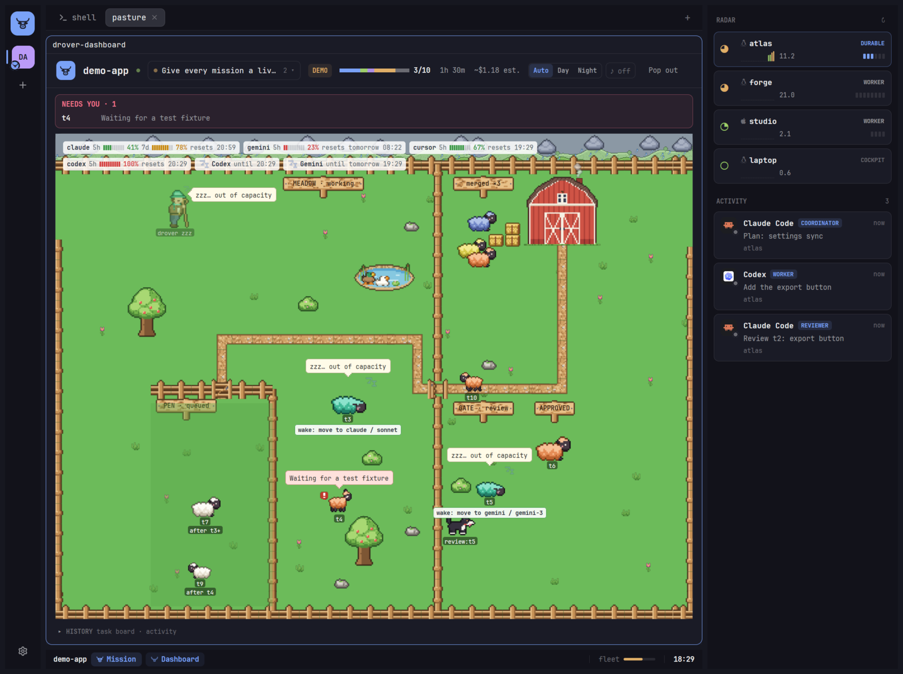

# drover

A cockpit for coding agents spread over several machines. A narrow rail on the
left holds your projects as coloured avatars, a radar on the right shows every
machine's load and every running agent, and a slim strip under the terminals
says what the swarm is doing. Each project gets a "pasture" tab: a live pixel
farm where sheep are tasks, a sheepdog does the reviews and merged work goes to
the barn. It drives the [drover](https://github.com/jvdp11/drover) engine, which
plans missions, places agents and merges their branches.

## What you see

The window has no titlebar. The canvas shows 8px around and between four
regions, each a `chrome` block with 10px corners, left to right:

- **Rail** (56px, fixed width, drags the window). Top: the drover badge, a 38px
  `accent` square with 11px corners and the ox head (`drover.svg`, 24px, in
  `accent_foreground`). Under it one avatar per Herdr space: a 36px rounded (10px)
  square with the name's two initials (12px, semibold). Its colour is picked from
  the theme's `ansi4, ansi5, ansi6, ansi2, ansi3, ansi1, ansi12, ansi13` by a hash of
  the name. The selected space is filled with that colour (initials in
  `background`) and has a 3x22px `accent` bar on its left edge that springs in.
  Other spaces show the colour at 18% (`2e`) with a 33% border. A 10px dot
  top-right shows the space status: `blocked`, `working` or `done` colour. A
  16px `accent` disc with horns (`horns.svg`) sits bottom-left on folders drover
  knows as projects. Below the avatars a `+` button; at the bottom a gear.
- **Centre column**, top to bottom:
  - **Tabs** (40px): Herdr's shipped `tabs` mod. This bar also drags the window.
  - **Terminals**: the active tab's panes, 8px apart, 10px corners, `background`
    fill, a 1px `border` outline that turns `accent` on focus, and a 28px
    header (shipped `pane` mod) that always shows. A hidden 368px side panel
    (280-900px) to the right of them stacks the shipped `files` and `changes`
    mods.
  - **Strip** (30px, 11px text, `muted`): on the left the space's name
    (semibold, `foreground`) and git branch (with `git-branch.svg`). In a project
    folder (not home, not a remote space) two chips follow: **Mission** (`accent`
    at 13% fill, ox head icon) and **Dashboard** (`accent` at 8%, horns icon that
    pulses at 1600ms while a mission runs in this folder, plus a `blocked` count
    badge when this project's drover agents need you). On the right: `N need you`
    (a 6px `blocked` dot pulsing at 1000ms), a braille spinner (80ms per frame) with
    `N working`, `N done`, or `swarm idle` when no agent runs. Then a 1x12px
    divider, `fleet` and a 50x4px load bar, then another divider and the clock
    (`HH:MM`, semibold).
- **Radar** (300px, 220-520px, scrolls). `RADAR` heading (10px semibold, `dim`)
  with a `↻` probe button. One tile per machine (8px corners, `surface`, 1px
  border that turns `accent` at 40% when drover agents run there, half opacity
  when offline): a 20px ring glyph `○ ◔ ◑ ◕ ●` for load per CPU, the OS glyph
  (Linux or Apple), the name, a role tag (`DURABLE` in `accent`, `WORKER` in
  `muted`, `COCKPIT` in `dim`), a 20-bar sparkline of the last load samples
  (2px bars up to 16px tall, older bars fainter), the load number, and one 4x8px
  slot per allowed agent (up to 8), filled `accent` for each one running there.
  Load colours: `ansi2` up to 50% per CPU, `ansi3` up to 80%, `blocked` above.
  Then `ACTIVITY` with a count and one card per live agent: a 26px tile with the
  program's icon and a 10px status dot, the program name, the drover role as a
  pill (`COORDINATOR`, `WORKER`, `REVIEWER`), how long since its status
  changed, the task (or terminal title), and the machine. With no agents: a `◇`,
  "No agents running" and an **Open a project** button. Last, `JUST NOW`: the
  six latest status changes ("Codex finished", "Claude Code needs you").

The **pasture** (the `drover-dashboard` mod) shows as a project tab, as a
dialog, or alone in its own window:

- A 54px header: the ox head on a 30px `accent` square, the project name (15px
  semibold), a live dot, the mission picker (160-420px: state dot, goal, mission
  count `N ▾`), a `DEMO` pill in demo mode, a 110x6px progress bar split into
  merged (`done`), approved (`ansi2`), in review (`ansi5`), working (`working`) and
  queued (`dim`) with `merged/total`, elapsed time, `~$1.18 est.` cost,
  **Auto / Day / Night**, `♪ off`/`♪ on`, **Pop out**, **Archive** (done or
  stopped missions), and the close `x` in a dialog or the window buttons
  (minimize, maximize, close) in the pop-out. Narrow headers drop the cost first,
  then elapsed, then fold Auto/Day/Night into one `☀`/`☾` button.
- **NEEDS YOU · N** (only when something does): a `blocked`-tinted box with one
  row per impediment (who, what, how long).
- The scene, drawn from 24x24 SVG sprites on a 360x170 art grid at a whole-number
  scale of 2-4: sky (`#9fd8f2` by day, `#f4c7a4` dawn, `#f0a070` dusk, `#24306a`
  night) with hills and weather, a pen of queued sheep at bottom left, the meadow
  where working sheep walk and graze, a gate to the review area with the
  sheepdog, an APPROVED spot, and a red barn top right that takes merged work
  (`merged ×N` sign). A pond with one or two ducks, trees, bushes, rocks, the
  drover at the top left. Usage chips run along the top: per agent, 5h and 7d
  windows as 10-cell bars with `% used` and reset time; agents that are out show
  `until HH:MM`. Each sheep has its task id under it and is coloured by model
  family (anthropic, openai, cursor, github, google, other). Size S/M/L draws it
  at 0.8x/1x/1.2x.
- A collapsed `▸ HISTORY task board · activity` that opens a 440px task board
  and timeline.

Dialogs, all in `popover` with 18px padding unless said otherwise:

- **Projects** (640x560, from `+`): tabs **Open / New / Clone**. Open: search
  box and a list (folder or branch icon, name 190px, path, `GitHub` tag, age of
  the last commit). New: name, folder chips (`~/Work` and the parents of known
  projects), GitHub **No GitHub / Private repo / Public repo**. Clone: a repo URL.
- **drover settings** (720x640, from the gear): a 140px section list
  **Machines / Roles / Placement / Handoff**, the section on the right, and a footer
  with `~/.config/drover/config.json` (or "Unsaved changes"), **Cancel** and
  **Save**. Machines: per machine "Runs agents" and "Durable host" toggles and an
  "agents at once" stepper (1-32). Roles: one tab per role, the ordered
  agent+model chain (click a model to cycle it, ↑ ↓ ×, `+ Agent` to add),
  preferred machines in order, "Durable only", "Different model family".
  Placement: skip battery, minimum free disk (GB), default agents per machine.
  Handoff: GitHub / NAS / Direct, and "Delete merged branches on the remote too".
- **Start a mission** (600x380): the ox head, "Start a mission", the folder,
  a 130px goal box with an `accent` border, attached image chips (28px thumbnail,
  name, `x`), "Paste a screenshot or drop an image file to attach it.", an
  **Unattended** switch (on by default), **Tasks at once** `− 3 +` (1-8),
  "coordinator → workers → cross-family review → merge", **Cancel** and
  **Start mission**.
- **Project home** (a "home" tab, not a dialog; centred, up to 980px): a 56px
  avatar with horns, name (24px), folder, branch, `GitHub · owner/repo`, an
  **Open dashboard** button, a big **Start a mission** card, a MISSIONS card
  (up to 8: state dot, goal, age, **Archive**, summary, a 120x4px merged bar,
  `merged/tasks merged · state`, `N archived`) beside a 380px RECENT COMMITS card
  (8 commits: hash in `accent`, subject, age).
- **Terminal right-click menu** (250x340 popup, 31px rows with 7px corners and a
  14px icon): Herdr's own items (Split right, Split down, Zoom, send right-clicks
  to the pane, Close pane), then on drover-labelled terminals a divider and
  **Hand over coordinator…**, **Move task to another agent…** or
  **Move review to another agent…**, and **Open dashboard**.
- **Hand over** (460x470, modal): the title (`Hand over coordinator · repo`,
  `Move task t3`), one 36px row per installed agent with `41% used · resets 20:58`,
  `usage unknown` or `out until 20:28` (out rows at 45% opacity, not clickable),
  a "Reason (optional)" field, **Cancel** and **Hand over**.

## How it behaves

Agent status, everywhere: `working` uses the theme's `working` colour and pulses
(opacity 0.35-1, 1200ms); `blocked` (and `error`) uses `blocked` and pulses
faster (700ms) and counts as "need you"; `done` uses `done`, steady; `idle` uses
`idle`, steady. Radar cards of working or blocked agents get a border in their
colour and a small shadow.

- **Rail:** click an avatar to select the space. Right-click a project space
  (a folder that is not home, not remote) to open its pasture tab. Click the red
  dot of a blocked space to show that agent's terminal. `+` opens Projects; the
  gear opens settings.
- **Strip:** **Mission** opens Start a mission. **Dashboard** opens (or selects)
  the project's `pasture` tab. `N need you` and the red badge jump to the
  longest-blocked agent's terminal; each click goes to the next one.
  `ctrl-shift-d` opens the pasture as a quick-look dialog at 95% of the window.
  The mission list refreshes every 15s, the clock with it.
- **Radar:** `drover status` every 60s, `uptime` on each online machine every
  15s; `↻` probes every machine now. Click an agent card to focus its pane
  (switching space and tab), or peek it when it has none.
- **Projects:** type to filter, ↑/↓ and Enter to open, Esc to close. Opening a
  project selects its space, or makes one with a `shell` tab and a `home` tab
  (the project home). New and Clone create the folder (and the GitHub repo)
  first.
- **Settings:** changes stay local until **Save**, which writes them through
  `drover config` and closes the dialog.
- **Start a mission:** the draft (goal, images, Unattended) is saved per folder
  600ms after each change and comes back next time; Esc, Cancel and `x` keep it.
  Pasting with an image on the clipboard attaches it; a pasted image path on its
  own line becomes an attachment. **Start mission** runs it and notifies "Mission
  started" with "<agent> coordinates on <machine>"; errors such as "Nowhere to run the
  coordinator" show in red.
- **Project home:** refreshes every 20s. Click a mission to open its pasture;
  **Archive** hides done or stopped ones; `N archived` opens the pasture with
  archived missions shown.
- **Pasture:** polls every 1.5s. A queued task's sheep waits in the pen; working
  sheep walk and graze in the meadow; done ones trot through the review gate,
  where the sheepdog herds them; approved wait by the barn; merged ones go in.
  Changes play as short scenes, one after another: a new sheep, a reroute, done,
  review, changes, approve, merge, stuck (a red `!` and a bubble), a coordinator
  handover (a second drover walks in). Sleeping sheep (agent out of capacity)
  say "zzz… out of capacity" with a **wake: move to agent / model** button.
  Weather follows the mission's agents: clear, cloudy at 70%+, overcast at 90%+,
  rain when one is out, a rainbow when everything is merged; hover the sky for
  why. Auto follows the local clock (dawn 6-8, day 8-18, dusk 18-20, night
  20-6); at night the barn window is lit, stars show and an owl flies between
  perches. Sound plays a bleat when a worker is done and a chime on a merge
  (off by default). Time and sound are remembered per viewer.
- **Sheep panel:** click a sheep for a 380px panel on the right: agent, machine,
  status, a 210px terminal tail refreshed every 2s, a message box, and
  **Open terminal**, **Review**, **Merge**, **Drop** (asks **Confirm drop**),
  **Move to… ▾** with the alternatives and their usage. Clicking the drover opens
  the coordinator's panel with **Replace coordinator… ▾**. Esc or clicking
  outside closes it.
- **Pop out:** runs `drover dashboard --window`, which opens a second Herdr
  window (its own home) with only a 14px drag grip and the pasture; the tab it
  came from closes. Double-click the grip to maximize.
- **Terminal menu:** ↑/↓ move, Enter runs, Esc closes. The drover items open
  the Hand over dialog or the pasture dialog (1120x760).
- **Hand over:** pick a row, Enter or **Hand over**; a notification says done
  or failed, and the error stays in the dialog.

## Built from

Layout `layouts/drover.json`: root `row`, `titlebar: "none"`, `theme: "omarchy"`,
`terminal_menu: "drover-menu"`, font and UI font `JetBrainsMono Nerd Font` 14,
`background: "canvas"`, `padding: 8`, `gap: 8`, `terminal_padding: [12, 10]`,
`preview: "layouts/drover.svg"`.

- `rail`: block, 56px, `resizable: false`, `window_drag`, mod `drover-rail`.
- `center`: column, gap 8:
  - `tabs`: block, 40px, `window_drag`, shipped mod `tabs`.
  - `work-body`: row, gap 8: `main` (block, `tab: "active"`, pane style above,
    header mod `pane`) and `panel` (column, `hidden`, 368px, min 280, max 900)
    holding a `stack` `panel-body` of shipped mods `files` and `changes`.
  - `strip`: block, 30px, mod `drover-strip`.
- `sidebar`: block, 300px, min 220, max 520, mod `drover-radar`.

All blocks except `main` and `panel-body` are `background: "chrome"`,
`radius: 10`. Keys: `"layout:drover": { "ctrl-shift-d": "drover-strip.dashboard" }`.

Mods (all `place: "none"`; colours only from `theme()`):

| Mod | Shown as | Props |
|---|---|---|
| `drover-rail` | the rail block; ships `drover.svg` and `horns.svg` | none |
| `drover-strip` | the strip block; handles the `dashboard` command (`nextCommand`) | none |
| `drover-radar` | the sidebar block; shares `drover.status` and `drover.load` | none |
| `drover-projects` | dialog 640x560 | none |
| `drover-settings` | dialog 720x640 | none |
| `drover-mission` | dialog 600x380 | `space`, `folder`, `name` |
| `drover-project` | tab `home` | `folder`, `name` |
| `drover-dashboard` | tab `pasture`, dialog, or pop-out window; ships `sprites/` (SVG, made by `make_sprites.py`) and `sounds/` (`bleat.mp3`, `chime.mp3`, CC0, made by `make_sounds.py`) | `folder`, `name`, `space`, `mission`, `showArchived`, `popout`, `demo` (+ `time`, `weather`, `panel`, `move`, `owl`, `ducks`, `events`) |
| `drover-menu` | terminal context menu, popup 250x340 | `tab`, `target` |
| `drover-handover` | dialog 460x470, modal | `kind` (`coordinator`/`task`/`review`), `title`, `repo`, `mission`, `task`, `name`, `agents` (demo) |
| `drover-titlebar` | the pop-out window's 14px drag grip | none |

Icons come from the shipped `workspace-chrome` mod (`plus`, `settings`,
`git-branch`, `x`, `folder`, `git-compare`, `minus`, `square`, `panel-right`,
`terminal`, `square-pen`) and Herdr's `icons/` (`claude`, `codex`, `cursor`,
`copilot`).

Herdr functions: `spaces`, `agents`, `terminals`, `panes`, `machines`, `focused`,
`home`, `theme`, `keys`, `settings`, `window`, `shared`/`setShared`, `props`,
`openOverlay`/`closeOverlay`, `run`, `exec`, `notify`, `playSound`,
`nextCommand`. Commands run: `space.select`, `space.new`, `tab.new`,
`tab.select`, `tab.close`, `pane.focus`, `terminal.peek`, `window.minimize`,
`window.maximize`, `window.close`, plus Herdr's own menu commands.

Programs it runs, through `exec`:

- `drover` (the engine): `status --json [--max-age 0]` (radar), `mission list
  --json` (strip), `mission list --repo F --all --json` and `mission archive`
  (project home), `project list|open|add|new` (projects), `config --json
  [--set-json]` (settings, handover), `mission start … --json [--auto]
  [--image] [--space]` (mission), `agent list --json`, `coordinator replace`,
  `task reroute` (handover), and `dashboard --json`, `dashboard --window`,
  `peek`, `task review|merge|drop|reroute`, `say`, `coordinator replace`,
  `agent clear`, `mission archive` (pasture).
- `git` (`rev-parse` in the menu, `log` and `remote get-url` on the project
  home), `uptime` (radar, locally and on other machines through `exec`'s `on`,
  i.e. herdr-core `hc`), `sh -c` for `command -v <agent>` (handover), draft
  files and `wl-paste` (mission), `wl-copy` (pasture).

## Watch out

- **Hard requirement: the drover engine.** Eight of the eleven mods call
  `drover` (`engine/drover`, one Python 3.9+ file) by `exec`, and the engine
  itself drives herdr-core's `hc`. The layout folder alone is not enough: also
  `git clone https://github.com/jvdp11/drover` and run its `install.sh`, or put
  `engine/drover` on `PATH` as `drover`. Without it the radar, Projects, settings
  and Hand over show the exec error in red, and the pasture says "Waiting for
  mission data".
- What runs programs: `drover-radar` (`drover`, `uptime` here and on every
  machine `hc` knows), `drover-strip`, `drover-projects`, `drover-settings`,
  `drover-project` (`drover`, `git`), `drover-mission` (`drover`, `sh`,
  `wl-paste`), `drover-handover` (`drover`, `sh`), `drover-menu` (`git`, on the
  space's machine), `drover-dashboard` (`drover`, `sh` + `wl-copy`). Through
  `drover` they start and stop coding agents (unattended with `--auto`, which for
  Codex means `--dangerously-bypass-approvals-and-sandbox`), push branches, and
  with `project new --github` create GitHub repos.
- Files outside the mod folders: `drover-mission` reads and writes
  `~/.local/state/drover/drafts/`; the engine owns `~/.config/drover/` and
  `~/.local/state/drover/`. **Pop out** makes a second Herdr home under
  `~/.local/state/drover/pasture-app/` and links the `drover-*` mods there from the
  drover checkout, not from your Herdr home.
- The layout sets `terminal_menu` to `drover-menu`, which replaces Herdr's menu
  for terminals in this layout (its own items are copied in). It adds
  `ctrl-shift-d` under `layout:drover`; merge that into `keys.json` (install.sh
  does, without touching other keys).
- `theme: "omarchy"` expects `themes/omarchy.json`; install.sh links Omarchy's
  generated theme there. Elsewhere, change it to a theme you have.
- Needs the shipped mods `tabs`, `pane`, `files`, `changes` and
  `workspace-chrome`, and the font JetBrainsMono Nerd Font.
- A fresh build gets wrong: the pasture tab is found again by `name ===
  "pasture" && named`, so open it with `tab.new` `name: "pasture"`; reusing it
  for another mission goes through shared `drover.pasture.pick`. The quick look
  can't be toggled closed by the key (Herdr has no overlay list), only by Esc.
  Sprites carry a 1px transparent margin and are drawn one pixel out and clipped,
  or a faint edge line shows. The header's width estimates are at zoom 1 and
  divided by `settings().zoom`.
- Limits: radar sparkline 20 samples, log 6 lines, agent slots drawn up to 8;
  project home 8 missions and 8 commits; Projects shows up to 6 folder chips;
  mission "Tasks at once" 1-8; machine "agents at once" 1-32. "Issues and pull
  requests from GitHub appear here next" on the project home is a placeholder.
- After editing mods, switch layouts twice (`ctrl-shift-l`) to reload them.

## Done when

- `herdr-app check` passes for every `mods/drover-*` folder, and `layout.switch
  drover` shows the rail, tabs, terminals, strip and radar with 8px gaps.
- With `drover` on `PATH`, the radar lists each machine with a ring, sparkline
  and role tag within a minute; `↻` probes again.
- An agent running in `hc` with label `drover.role=worker` shows as a radar card
  with a `WORKER` pill, and the strip counts it under working/need you/done.
- `+` opens Projects; opening a folder makes a space with `shell` and `home`
  tabs, and its avatar shows horns on the rail.
- In that space, **Mission** opens Start a mission and **Dashboard** opens a
  `pasture` tab; `ctrl-shift-d` opens the same pasture as a dialog.
- `tab.new` with mod `drover-dashboard` and props `{"demo": true, "folder":
  "/demo", "name": "demo"}` draws the farm with sheep in the pen, meadow and
  review area, the `DEMO` pill and usage chips; clicking a sheep opens its
  panel; **Day**/**Night** change the sky.
- **Pop out** opens the pasture alone in a second window with window buttons.
- Right-clicking a drover worker's terminal shows **Move task to another
  agent…**, which opens Hand over listing installed agents with their usage.
- The gear opens settings; **Save** writes `~/.config/drover/config.json`.
